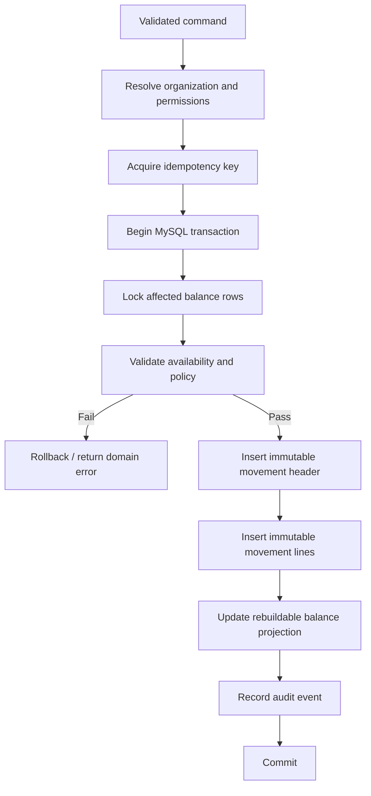

# Inventory Movement Lifecycle

## Principle

The ledger contains posted business facts, not editable drafts.

Draft workflow belongs to the originating document such as a purchase receipt, stock transfer request, count session, or sales dispatch. Posting converts an approved command into immutable ledger evidence.

## Generic posting flow



## Receipt

A receipt adds positive quantity to a receiving location.

For procurement receipts, source-reference links to the posted goods receipt.

## Issue

An issue removes physical stock from a location.

Future sales/delivery posting must never issue more than available stock unless a narrowly controlled negative-stock override is exercised.

## Transfer

A transfer posts both legs atomically.

```text
Source location       -50 KG
Destination location  +50 KG
Net organization qty    0 KG
```

An in-transit workflow may later use a dedicated transit location when dispatch and receipt occur at different times.

## Adjustment

Adjustments represent discovered physical variance, not convenient stock editing.

Required controls should include:

- reason code;
- counted/evidence context;
- privileged business reason above threshold;
- maker-checker approval above configured threshold;
- fraud-risk event.

## Reversal

A reversal is a separate movement.

Rules:

- original movement remains unchanged;
- one movement cannot be reversed repeatedly without explicit policy;
- reversal references original public/internal identity;
- reversal uses the inverse base quantities and inventory values;
- reversal reason is mandatory;
- actor is recorded;
- any downstream document state is updated by its owning domain, not by editing the ledger.

## Backdating

`occurred_at` may differ from `posted_at`.

Backdating beyond a configured window is privileged. Accounting-period policy will later further restrict backdated postings.

## Reconciliation

Provide an operational command/job that recomputes projected balances from the ledger and reports differences.

Reconciliation must never "fix" the ledger by rewriting movements.
